# SAP IN WH v3.3 – Chỉnh vị trí và kiểu số phiếu

## Bản mới v3.3

- [Tải INWH_TOOL_v3.3.zip](INWH_TOOL_v3.3.zip)
- [File HTML độc lập](INWH_v3.3.html)
- [Hướng dẫn](HUONG_DAN_V3.3.txt)

Giữ giao diện V2, tùy chọn bỏ trang trắng và đối soát CSV; bổ sung phần **Chỉnh vị trí và kiểu số phiếu**. Chọn góc hoặc tọa độ mm; cỡ chữ 8–72 pt; Helvetica/Times/Courier; thường/đậm/nghiêng; màu; khung chữ nhật hoặc bầu dục; độ dày, khoảng đệm và nền trắng tùy chọn.

Mặc định chừa lề an toàn 10 mm, cỡ 18 pt, góc dưới phải. Toàn bộ chữ và khung được tính theo kích thước font, có dự phòng phần nghiêng và biên chữ; vị trí được giới hạn trong phần giao nhau của Media/Crop/Trim đã trừ lề. Vị trí vượt mép được đưa về bên trong, số quá lớn không vừa sẽ báo lỗi thay vì xuất chữ bị cắt.

Chọn PDF rồi bấm **Xem trước trên PDF** trong phần chỉnh số. Trang xem trước được tạo bằng cùng hàm đóng số với PDF đầu ra. Kéo khung nét đứt xanh để chỉnh vị trí, thả chuột để cập nhật. Viền vàng là vùng lề an toàn; hai viền hướng dẫn không in lên PDF. Thiết lập áp dụng cho mọi trang có WH. Thay đổi thiết lập yêu cầu tạo lại PDF/CSV.

Đã kiểm tra cú pháp HTML đóng gói; xử lý 23 WH/58 trang và 50 trang khi bỏ trang trắng; các tọa độ cực trị; 12 kiểu font × 6 vị trí; Media/Crop/Trim lệch gốc; giới hạn cỡ số; pipeline tạo trang xem trước và controller kéo thả bằng DOM/canvas mô phỏng. PDF thực tế đã được kết xuất và kiểm tra toàn bộ nhãn nằm trong lề an toàn cho ba trường hợp mặc định, khung chữ nhật và khung bầu dục.

Chưa xác minh giao diện/renderer trên trình duyệt thật hoặc máy in của người dùng. Chưa có PDF vừa in lỗi nên chưa khẳng định nguyên nhân duy nhất của việc bị cắt số. Kiểm tra giấy/hướng theo PDF và dùng Vừa trang/Fit nếu bản xem trước của máy in cắt mép. Nên thử một trang trước khi in cả tập.

---

## Các bản trước

# SAP IN WH v3.2 – Chọn bỏ trang trắng

## Bản mới v3.2

- [Tải INWH_TOOL_v3.2.zip](INWH_TOOL_v3.2.zip)
- [File HTML độc lập](INWH_v3.2.html)
- [Hướng dẫn](HUONG_DAN_V3.2.txt)

Giữ giao diện V2 và thêm ô **Bỏ trang trắng (kể cả trang chỉ có số trang/ngày giờ)** bên dưới tiền tố/số bắt đầu. Mặc định tắt. Đổi lựa chọn rồi bấm Bắt đầu xử lý để tạo lại PDF và CSV.

Bộ lọc giữ trang có nội dung, hình ảnh hoặc nét vẽ được phát hiện. Không dùng tiền tố mã vật tư để kết luận trang trắng. Trang trắng hoàn toàn ngoài WH được đối soát thành dòng riêng; không làm tăng số WH và không được đánh số phiếu. Trang nguồn được giữ theo thứ tự ban đầu. CSV có cả trang gốc, trang được giữ, trang bị bỏ và số trang đầu ra.

Kiểm tra phần xử lý bằng PDF mẫu: tắt = 58 trang; bật = 50 trang; đều đủ 23 WH. Thêm một trang trắng thật: 59 → 50 khi bật (bỏ 9 trang). Chèn hình ảnh và nét vẽ lên hai trang ngày giờ: cả hai trang được giữ. Bốn trang tiếp nối còn vật tư không bị bỏ. Nội dung và ảnh kết xuất ngoài vùng thêm số khớp trang nguồn; CSV khớp số trang thực tế. Kiểm thử dùng Node và DOM mô phỏng; chưa xác minh thao tác trình duyệt thật do giới hạn môi trường.

---

## Các bản trước

# SAP IN WH v3.1 – Giao diện V2

## Bản mới v3.1

- [Tải INWH_TOOL_v3.1.zip](INWH_TOOL_v3.1.zip)
- [File HTML độc lập](INWH_v3.1.html)
- [Hướng dẫn](HUONG_DAN_V3.1.txt)

Dùng bố cục và CSS gốc của `SAP_IN_WH_HTML_v2.0.zip` trên Release: hai ô tiền tố/số bắt đầu, hai chế độ, khung kéo thả PDF, nút xử lý/tải/in và bảng thống kê đối soát. Đã bỏ hoàn toàn bảng nhập dạng Excel, nút thêm dòng, chọn ô, co giãn cột và hoàn tác. Bảng cuối chỉ hiển thị kết quả, không có ô nhập.

Cách dùng: mở HTML bằng Edge/Chrome → đặt tiền tố và số bắt đầu → chọn PDF → Bắt đầu xử lý → tải PDF/CSV. Tab đối soát dùng ô dán danh sách WH; có thể dán thêm cột số phiếu bằng Tab nếu cần số riêng. PDF luôn giữ thứ tự nguồn, đủ mọi trang và số bản có sẵn. Nếu đã có hai bản/WH thì khi in chọn 1 copy.

Phần xử lý giữ kiểm tra WH đầy đủ, trang tiếp nối, số phiếu thiếu/trùng và CSV gắn với lần tạo PDF thành công. Không dùng nhánh nhận nhầm WT làm WH hoặc lấy trang đầu PDF thay cho WH lỗi. HTML đã tích hợp thư viện, không dùng CDN.

Đã kiểm tra cú pháp HTML đóng gói, các handler bằng DOM mô phỏng, PDF 58 trang/23 WH, số bắt đầu 98 qua 100, danh sách đảo thứ tự, dữ liệu thiếu/thừa/trùng, CSV và tính nguyên vẹn nguồn PDF. CSS nền được đối chiếu với CSS gốc V2. Chưa xác minh giao diện và tải file trong trình duyệt thật do giới hạn môi trường thử nghiệm.

---

## Các bản trước

# INWH – Tự động đánh số phiếu PDF v3.0

## Bản mới v3.0

- [Tải INWH_TOOL_v3.0.zip](INWH_TOOL_v3.0.zip)
- [File HTML độc lập](INWH_v3.0.html): tải về và mở bằng Edge/Chrome.
- [Hướng dẫn](HUONG_DAN_V3.txt)
- [Phân tích hai bản v2.0 và thay đổi của v3.0](PHAN_TICH_V3.md)

Chế độ chính: chọn PDF → tự nhận diện WH → lập số theo tiền tố, số bắt đầu và số chữ số tối thiểu → tạo PDF → tải PDF/CSV. Bảng co giãn để dán hoặc sửa số riêng được giữ trong chế độ Nhập / chỉnh bảng.

Có hai CSV: đối soát theo WH và đối chiếu từng trang. CSV chỉ lấy từ lần tạo PDF thành công; đổi dữ liệu hoặc thiết lập sẽ yêu cầu tạo PDF lại. Trong Excel, nhập cột WH/Số phiếu dạng Text để giữ nguyên nhãn như 06-01.

Mặc định giữ toàn bộ trang và số bản có sẵn. Tùy chọn bỏ trang chỉ có số trang/ngày giờ được tắt sẵn. Không lấy số nhiệm vụ bất kỳ làm WH và không dùng trang đầu toàn bộ PDF để thay cho WH lỗi.

Kiểm tra phần xử lý bằng PDF mẫu: 23 WH/58 trang khi giữ nguyên; 23 WH/50 trang khi bật bỏ 8 trang ngày giờ; sắp xếp theo bảng WH cho kết quả đúng; hai CSV khớp PDF. Cú pháp HTML đóng gói và mô hình bảng 10.000 dòng đã được kiểm tra. Kiểm thử giao diện dùng DOM mô phỏng; chưa xác minh thao tác tải trực tiếp trong Edge/Chrome vì giới hạn môi trường. Chi tiết trong báo cáo phân tích.

---

## Các bản trước

# INWH – Đánh số phiếu PDF

## Bản HTML độc lập v2.0

- [Tải gói INWH_TOOL_v2.0.zip](INWH_TOOL_v2.0.zip)
- [File HTML tích hợp thư viện](INWH_v2.0.html) — tải về máy rồi mở bằng Edge/Chrome.
- [Hướng dẫn v2.0](HUONG_DAN_INWH_v2.0.txt)

Chọn PDF SAP, dán bảng WH – Số phiếu và xuất PDF đã đánh số. Không cần Excel, Python, Foxit, server hoặc mạng khi chạy. Bảng hai cột hỗ trợ kéo rộng cột, đổi chiều cao, copy/paste nhiều ô, tự thêm dòng và hoàn tác. Ghép theo WH đủ 10 chữ số; báo thiếu/thừa/trùng trước khi xuất. Giữ nguyên thứ tự PDF, toàn bộ trang và số bản có sẵn.

Cách dùng: giải nén ZIP → mở `INWH_v2.0.html` → chọn PDF → dán WH/số phiếu → kiểm tra → xuất PDF. Nếu trình duyệt chưa tải tự động, bấm liên kết tải kết quả được tạo trong công cụ. Nếu PDF đã có hai bản mỗi WH, chọn 1 copy khi in.

Kiểm tra đã thực hiện: cú pháp các module trong HTML đóng gói; logic ghép 23 WH trên 58 trang; dán 1/2 cột và đảo thứ tự WH; phát hiện lỗi; hoàn tác/làm lại; mô hình bảng 10.000 dòng; xuất PDF đúng số phiếu trên đủ 58 trang. Văn bản nguồn giữ nguyên, ảnh kết xuất ngoài vùng thêm số ở chân trang không đổi. Kiểm tra logic giao diện dùng môi trường mô phỏng DOM; chưa xác minh thao tác mở/tải file trực tiếp trên Edge/Chrome do giới hạn môi trường thử nghiệm.

Hỗ trợ PDF có lớp văn bản theo mẫu Warehouse Order / Lệnh kho và Trang x/y. Không dùng OCR cho PDF scan. Trang xoay hoặc không đủ căn cứ nhận diện sẽ báo lỗi. Giấy phép thư viện nằm trong ZIP và thư mục [THU_VIEN_GIAY_PHEP](THU_VIEN_GIAY_PHEP).

## Các phiên bản và tài liệu trước

Phần bên dưới mô tả luồng Excel/engine trước đây; các tùy chọn lọc và sắp xếp của luồng đó không phải hành vi của HTML độc lập trên.

---

# SAP IN WH PORTABLE v1.0 - Xử Lý Lọc Trang Thừa & Đóng Số Phiếu Kho SAP

Hệ thống tự động hóa xử lý file PDF phiếu lệnh kho (Warehouse Order - WH) xuất từ SAP EWM / ERP. Hỗ trợ đối soát theo danh sách copy/paste từ Excel, tự động nhận diện và loại bỏ trang thừa (chữ ký, ngày giờ in không có mã vật tư), bảo toàn 100% định dạng và mã vạch Barcode SAP, đóng dấu số đơn chuẩn xác ở góc dưới bên phải.

---

## 1. Sơ đồ Kiến trúc & Luồng Nghiệp Vụ

```mermaid
flowchart TD
    subgraph UserInterface ["1. Giao diện người dùng (IN_PHIEU_WH.xlsm)"]
        PasteWH["1. Copy & Dán danh sách Mã WH vào Cột C"]
        InputLabel["2. Nhập số đơn vào Cột D (vd: 06-01, 06-02...)<br/>(Có nút 'Tự điền số đơn nhanh' hỗ trợ tự sinh)"]
        SelectPDF["3. Chọn file PDF gốc xuất từ SAP"]
        BtnRun["4. Bấm nút: [▶ 1. XỬ LÝ & ĐỐI SOÁT PDF]"]
        PasteWH --> InputLabel --> SelectPDF --> BtnRun
    end

    subgraph VBA_Bridge ["2. Cầu nối VBA Macro"]
        ExportMap["VBA xuất bảng mapping sang mapping_wh.csv"]
        CallEngine["Gọi ngầm wh_engine.exe qua WScript.Shell<br/>(Ẩn hoàn toàn cửa sổ CMD)"]
        ExportMap --> CallEngine
    end

    subgraph PortableEngine ["3. Engine Portable (wh_engine.exe)"]
        PDF_Parse["1. Quét nội dung text & bóc tách mã WH từng trang"]
        PDF_Filter["2. Lọc bỏ trang thừa<br/>(chỉ có chữ ký/ngày giờ, không có mã vật tư)"]
        PDF_Lookup["3. So khớp mã WH với bảng mapping Excel:<br/>- Khớp: Gán số đơn tương ứng<br/>- Thiếu/Thừa: Ghi nhận cảnh báo đối soát"]
        PDF_SortAndStamp["4. Sắp xếp lại thứ tự PDF theo đúng bảng Excel<br/>và đóng dấu số thứ tự góc dưới bên phải"]
        PDF_Export["5. Xuất PDF sẵn sàng in & CSV đối soát"]

        PDF_Parse --> PDF_Filter --> PDF_Lookup --> PDF_SortAndStamp --> PDF_Export
    end

    subgraph Result ["4. Kết quả & In ấn"]
        VBA_Read["VBA cập nhật trực tiếp vào từng dòng Excel:<br/>-  Đã khớp & đóng số<br/>-  Đã lọc X trang rác<br/>- ❌ THIẾU: Có trong Excel nhưng không thấy trong PDF"]
        OpenPDF["Bấm nút: [🖨 2. MỞ PDF KẾT QUẢ ĐỂ IN]<br/>(Chọn 1 copy khi gửi máy in)"]
        VBA_Read --> OpenPDF
    end

    BtnRun --> ExportMap
    CallEngine --> PDF_Parse
    PDF_Export --> VBA_Read
```



---

## 2. Tính năng nổi bật của bản V1.0

1. **Zero-Install (Chạy ngay không cần cài đặt):**
   - Đã được đóng gói sẵn thành file thực thi `wh_engine.exe` độc lập (~140MB gồm đầy đủ engine PyMuPDF và C-runtime).
   - Máy tính kho không cần cài đặt Python, không cần cài thư viện, không cần quyền Admin.
2. **Kiểm soát chủ động bằng Bảng Mapping (Excel-Driven):**
   - Người dùng tự dán danh sách mã WH và nhập số thứ tự cần in bên cạnh (`06-01`, `06-02`...).
   - PDF đầu ra được tự động gom nhóm và **sắp xếp theo đúng thứ tự danh sách Excel**, giúp nhân viên in xong có ngay xấp phiếu theo đúng thứ tự phân loại.
3. **Bộ lọc thông minh (Smart Material Detector):**
   - Tự động nhận diện các trang phụ (trang 2/2) chỉ có chữ ký và ngày giờ in mà không có mã vật tư để loại bỏ.
   - Giữ lại đầy đủ các trang 2/2 nếu còn chứa dòng vật tư (ví dụ mã `BIW32026240`).
4. **Bảo toàn 100% định dạng SAP:**
   - Sử dụng cơ chế vector stream modification, không convert qua ảnh raster hay Word.
   - Barcode (Code 128 / QR) giữ nguyên độ sắc nét cao nhất, đầu quét Barcode kho đọc nhạy 100%.
5. **Cảnh báo thiếu / thừa đơn trực tiếp trên Excel:**
   - Tô màu đỏ nếu có đơn trong kế hoạch Excel nhưng file PDF của SAP lại thiếu.
   - Tô màu vàng nếu có đơn lạ xuất hiện trong PDF mà chưa được gán số trong Excel.

---

## 3. Cấu trúc thư mục

```text
INWH/
├── IN_PHIEU_WH.xlsm            # File Excel điều khiển chính (giao diện người dùng)
├── wh_engine.exe               # Engine Portable độc lập (Zero-Install)
├── wh_engine.py                # Mã nguồn Python của Engine
├── ModWHMappingController.bas   # Mã nguồn module VBA
├── build_portable.bat          # Script tự đóng gói lại exe nếu có chỉnh sửa mã
├── HUONG_DAN_SU_DUNG.md        # Hướng dẫn chi tiết từng bước cho người vận hành
└── README.md                   # Tài liệu tổng quan kiến trúc
```

---

## 4. Hướng dẫn sử dụng nhanh

1. Mở file **`IN_PHIEU_WH.xlsm`**, bật **Enable Content / Enable Macros** nếu Excel yêu cầu.
2. Dán danh sách các mã WH cần in vào **Cột C (Mã Warehouse Order)**.
3. Nhập số đơn cần gán vào **Cột D** (hoặc bấm nút **"Tự điền số đơn nhanh"** để điền `06-01`, `06-02`...).
4. Bấm **"Chọn File PDF..."** để trỏ tới file PDF xuất từ SAP.
5. Bấm nút **"▶ 1. XỬ LÝ & ĐỐI SOÁT PDF"**: Hệ thống chạy ngầm trong 1-2 giây và hiển thị kết quả đối soát từng dòng.
6. Bấm nút **"🖨 2. MỞ PDF KẾT QUẢ ĐỂ IN"**: Trình xem PDF sẽ mở file đã được đóng số sẵn sàng in.
   - *Lưu ý:* Nếu PDF gốc của SAP đã có sẵn 2 bản cho mỗi WH, trong hộp thoại in chọn **Copies = 1**.
