# SAP IN WH PORTABLE v1.0 - Xử Lý Lọc Trang Thừa & Đóng Số Phiếu Kho SAP

Hệ thống tự động hóa xử lý file PDF phiếu lệnh kho (Warehouse Order - WH) xuất từ SAP EWM / ERP. Hỗ trợ đối soát theo danh sách copy/paste từ Excel, tự động nhận diện và loại bỏ trang thừa (chữ ký, ngày giờ in không có mã vật tư), bảo toàn 100% định dạng và mã vạch Barcode SAP, đóng dấu số đơn chuẩn xác ở góc dưới bên phải.

---

## 1. Sơ đồ Kiến trúc & Luồng Nghiệp Vụ

```mermaid
flowchart TD
    subgraph UserInterface ["1. Giao diện người dùng (IN_PHIEU_WH.xlsm)"]
        PasteWH["1. Copy & Dán danh sách Mã WH vào Cột C"]
        InputLabel["2. Nhập số đơn vào Cột D (vd: 06-01, 06-02...)<br/>(Có nút 'Tự điền số đơn nhanh' hỗ trợ tự sinh)"]
        SelectPDF["3. Chọn file PDF gốc xuất từ SAP"]
        BtnRun["4. Bấm nút: [▶ 1. XỬ LÝ & ĐỐI SOÁT PDF]"]
        PasteWH --> InputLabel --> SelectPDF --> BtnRun
    end

    subgraph VBA_Bridge ["2. Cầu nối VBA Macro"]
        ExportMap["VBA xuất bảng mapping sang mapping_wh.csv"]
        CallEngine["Gọi ngầm wh_engine.exe qua WScript.Shell<br/>(Ẩn hoàn toàn cửa sổ CMD)"]
        ExportMap --> CallEngine
    end

    subgraph PortableEngine ["3. Engine Portable (wh_engine.exe)"]
        PDF_Parse["1. Quét nội dung text & bóc tách mã WH từng trang"]
        PDF_Filter["2. Lọc bỏ trang thừa<br/>(chỉ có chữ ký/ngày giờ, không có mã vật tư)"]
        PDF_Lookup["3. So khớp mã WH với bảng mapping Excel:<br/>- Khớp: Gán số đơn tương ứng<br/>- Thiếu/Thừa: Ghi nhận cảnh báo đối soát"]
        PDF_SortAndStamp["4. Sắp xếp lại thứ tự PDF theo đúng bảng Excel<br/>và đóng dấu số thứ tự góc dưới bên phải"]
        PDF_Export["5. Xuất PDF sẵn sàng in & CSV đối soát"]

        PDF_Parse --> PDF_Filter --> PDF_Lookup --> PDF_SortAndStamp --> PDF_Export
    end

    subgraph Result ["4. Kết quả & In ấn"]
        VBA_Read["VBA cập nhật trực tiếp vào từng dòng Excel:<br/>-  Đã khớp & đóng số<br/>-  Đã lọc X trang rác<br/>- ❌ THIẾU: Có trong Excel nhưng không thấy trong PDF"]
        OpenPDF["Bấm nút: [🖨 2. MỞ PDF KẾT QUẢ ĐỂ IN]<br/>(Chọn 1 copy khi gửi máy in)"]
        VBA_Read --> OpenPDF
    end

    BtnRun --> ExportMap
    CallEngine --> PDF_Parse
    PDF_Export --> VBA_Read
```



---

## 2. Tính năng nổi bật của bản V1.0

1. **Zero-Install (Chạy ngay không cần cài đặt):**
   - Đã được đóng gói sẵn thành file thực thi `wh_engine.exe` độc lập (~140MB gồm đầy đủ engine PyMuPDF và C-runtime).
   - Máy tính kho không cần cài đặt Python, không cần cài thư viện, không cần quyền Admin.
2. **Kiểm soát chủ động bằng Bảng Mapping (Excel-Driven):**
   - Người dùng tự dán danh sách mã WH và nhập số thứ tự cần in bên cạnh (`06-01`, `06-02`...).
   - PDF đầu ra được tự động gom nhóm và **sắp xếp theo đúng thứ tự danh sách Excel**, giúp nhân viên in xong có ngay xấp phiếu theo đúng thứ tự phân loại.
3. **Bộ lọc thông minh (Smart Material Detector):**
   - Tự động nhận diện các trang phụ (trang 2/2) chỉ có chữ ký và ngày giờ in mà không có mã vật tư để loại bỏ.
   - Giữ lại đầy đủ các trang 2/2 nếu còn chứa dòng vật tư (ví dụ mã `BIW32026240`).
4. **Bảo toàn 100% định dạng SAP:**
   - Sử dụng cơ chế vector stream modification, không convert qua ảnh raster hay Word.
   - Barcode (Code 128 / QR) giữ nguyên độ sắc nét cao nhất, đầu quét Barcode kho đọc nhạy 100%.
5. **Cảnh báo thiếu / thừa đơn trực tiếp trên Excel:**
   - Tô màu đỏ nếu có đơn trong kế hoạch Excel nhưng file PDF của SAP lại thiếu.
   - Tô màu vàng nếu có đơn lạ xuất hiện trong PDF mà chưa được gán số trong Excel.

---

## 3. Cấu trúc thư mục

```text
INWH/
├── IN_PHIEU_WH.xlsm            # File Excel điều khiển chính (giao diện người dùng)
├── wh_engine.exe               # Engine Portable độc lập (Zero-Install)
├── wh_engine.py                # Mã nguồn Python của Engine
├── ModWHMappingController.bas   # Mã nguồn module VBA
├── build_portable.bat          # Script tự đóng gói lại exe nếu có chỉnh sửa mã
├── HUONG_DAN_SU_DUNG.md        # Hướng dẫn chi tiết từng bước cho người vận hành
└── README.md                   # Tài liệu tổng quan kiến trúc
```

---

## 4. Hướng dẫn sử dụng nhanh

1. Mở file **`IN_PHIEU_WH.xlsm`**, bật **Enable Content / Enable Macros** nếu Excel yêu cầu.
2. Dán danh sách các mã WH cần in vào **Cột C (Mã Warehouse Order)**.
3. Nhập số đơn cần gán vào **Cột D** (hoặc bấm nút **"Tự điền số đơn nhanh"** để điền `06-01`, `06-02`...).
4. Bấm **"Chọn File PDF..."** để trỏ tới file PDF xuất từ SAP.
5. Bấm nút **"▶ 1. XỬ LÝ & ĐỐI SOÁT PDF"**: Hệ thống chạy ngầm trong 1-2 giây và hiển thị kết quả đối soát từng dòng.
6. Bấm nút **"🖨 2. MỞ PDF KẾT QUẢ ĐỂ IN"**: Trình xem PDF sẽ mở file đã được đóng số sẵn sàng in.
   - *Lưu ý:* Nếu PDF gốc của SAP đã có sẵn 2 bản cho mỗi WH, trong hộp thoại in chọn **Copies = 1**.
